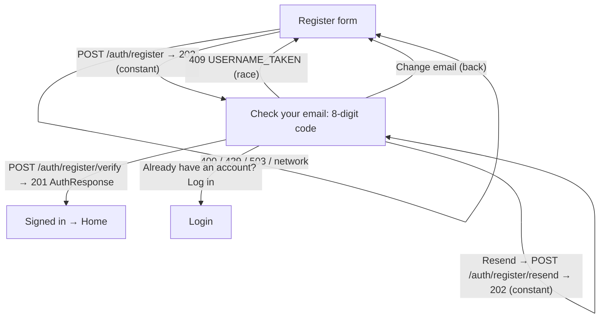

# Kabso Live — Phase 1.1 Screen & Copy Specs (contract v1.2)

Status: **Specification (A5, for KL-019 verify-first registration, KL-017 displayName, KL-018
first-launch language, KL-015 copy alignment).** Describes what to build; it does not claim
anything is built. Owner decisions: D15 (spec governs wording; ARB key names are an
implementation detail), D24 (sign-up never reveals email registration), D26 (first-launch
language), D27 (displayName rules).

Sources: [`../contracts/CONVENTIONS.md`](../contracts/CONVENTIONS.md) §4, §6, §7, §9 v1.2 ·
[`../contracts/openapi.yaml`](../contracts/openapi.yaml) (`register`, `registerVerify`,
`registerResend`, `updateMe`) · [`PHASE1_SCREENS.md`](PHASE1_SCREENS.md) (base spec; conventions,
global patterns §1 and error presentation §10 still apply) ·
[`../qa/KL-006_PHASE1_QA_REPORT.md`](../qa/KL-006_PHASE1_QA_REPORT.md) (QA-005, QA-006, QA-008,
§8.3 note A).

Notation is the same as PHASE1_SCREENS: layout top → bottom, **start/end** directional, side
gutter `spacing.lg`, tokens by name, every string ar + en. Key names below are suggestions; the
implementation may keep its own key names (D15) as long as the **text** matches.

## 0. What this supersedes in PHASE1_SCREENS.md

| PHASE1_SCREENS section | Status under v1.2 |
| ---------------------- | ----------------- |
| §1 "Locale" row | Replaced by §3 of this doc (same rule, plus persistence and server sync) |
| §3 Login item 1 (language Chip) | Replaced by the auth language switch (§3.2) |
| §4.2 username states | Unchanged (six states) |
| §4.3 Submit (201 → tokens, `EMAIL_TAKEN` branch) | **Replaced** by §1.1 (202 → code entry; no `EMAIL_TAKEN`) |
| §4 Display name rules + copy | **Replaced** by §2 |
| §6.1 Verify-email notice, §6.2 Verify result | **Retired from the mobile app** — every account is verified at creation. The API endpoints stay for future email-address changes |
| §8 item 1 (Profile verify banner) | **Retired** (no unverified accounts exist) |
| §9.1 Settings email row "Verified / Not verified" subtitle | **Retired**; the row shows the email only |
| §10 error copy | Amended by the §5 decisions (final text) and §1.4 (new code-entry copy) |

---

## 1. Verify-first registration

### 1.1 Flow



Register screen changes (rest of PHASE1_SCREENS §4 unchanged):

| Response from `POST /auth/register` | Behaviour |
| ----------------------------------- | --------- |
| 202 `{"status":"verification_pending"}` | Push **Code entry** (§1.2) with the normalized email (trim + lowercase). The Register form state (all four fields, including password) is kept in memory **only while the flow is open**, so "Change email" returns to a filled form. Cleared on success, on leaving the flow to Login, or on app termination. |
| 409 `USERNAME_TAKEN` | Username field → `taken` state (PHASE1_SCREENS §4.2), focus it. Includes names held by someone else's pending registration. |
| 400 `VALIDATION_FAILED` | Map `details[].field` to fields; displayName issues per §2; unknown field → form banner `errValidationFailed` |
| 429 `RATE_LIMITED` | Form banner `errRateLimitedWait` with `Retry-After` countdown; CTA disabled until 0 |
| 503 `SERVICE_UNAVAILABLE` | Form banner `errServiceBusyWait` (countdown when `Retry-After` present, else `errServiceUnavailable`) + selectable `errorIdLabel` |
| Network | Banner `errNetworkOffline` / `errNetworkTimeout` |
| `EMAIL_TAKEN` | Never returned under v1.2. If received from an old server, show `errUnknown` (do **not** reveal the email). Retire the `errEmailTaken` string from the register flow. |

The register CTA label stays `registerSubmit` ("Create account"). Under it, a `caption`
`textSecondary` line sets expectations: `registerCodeNotice`.

### 1.2 Code entry screen — "Check your email"

TopBar: `large`, back IconButton at start (flips; semantics `codeChangeEmail`), title
`codeTitle`. No language switch here (the code email was already sent in the register locale).

| # | Element | Component / spec | Spacing |
| - | ------- | ---------------- | ------- |
| 1 | Body | `codeBody` with `{email}` in a bidi isolate, `body` `textSecondary` | `sm` under title |
| 2 | Change email | Button `text` `codeChangeEmail`, aligned start → pops to Register and focuses Email | `xs` |
| 3 | Code input | **Code field** (§1.3) | `xl` |
| 4 | Status line | `caption`, live region: error (`error` colour + icon) or hint; default `codeExpiryHint` (`textSecondary`) | `sm` |
| 5 | Form banner | conditional (429 / 503 / network), PHASE1_SCREENS §1 banner | `lg` |
| 6 | Primary CTA | Button `primary` `large` `codeSubmit`; enabled at 8 digits; shows loading during verify. Exists in addition to auto-submit (screen readers, retries) | `xxl` |
| 7 | Resend | Button `secondary` `medium`, full width: `codeResendIn` (disabled countdown) → `codeResend` | `md` |
| 8 | Log in link | Row centred: `codeHaveAccount` + Button `text` `codeLogIn` → Login with identifier prefilled with the email; flow state cleared | `lg`; bottom `xl` + inset |

### 1.3 Code field

| Aspect | Spec |
| ------ | ---- |
| Structure | One real `TextField` (hidden caret, transparent text) under a row of **8 visual cells**, grouped 4 + 4 with an `md` gap between groups. Tapping any cell focuses the field. |
| Direction | Wrapped in `Directionality(ltr)` — cells always fill **left → right**, even in Arabic. Digits always Western 0–9 (`tabularFigures`). |
| Cell | 36 × 52 dp, radius `sm`, fill `surface`, 1 dp boundary per DESIGN_SYSTEM §2.4 rule 4; digit `headline` `textPrimary`, centred. Active (next) cell: 2 dp `focusRing`. Error: all cells 2 dp `error`. Disabled: 38 %. Total width 8×36 + 6×`xs` + `md` = 324 dp (fits 360 dp minus gutters). |
| Text scale > 1.3 | Cells are replaced by a single plain `KTextField` (height grows, `headline`, letter-spacing 4) — same behaviour, no clipping at 2.0 |
| Keyboard | `TextInputType.number`, `autofillHints: [AutofillHints.oneTimeCode]`, no autocorrect/suggestions, `TextInputAction.done` |
| Input filter | Accept only digits. **Normalize** Arabic-Indic (U+0660–0669) and Extended Arabic-Indic (U+06F0–06F9) digits to 0–9 as typed (Arabic keyboards emit them). Max 8. |
| Paste | Accept any pasted text: strip spaces, hyphens, NBSP and bidi marks, normalize digits; if exactly 8 digits remain → fill and auto-submit; if more/fewer → fill the first ≤ 8 digits, no submit, status `codePasteInvalid` |
| Auto-submit | When the 8th digit is entered, submit once. After a `TOKEN_INVALID`, do not auto-resubmit the same value; any edit re-arms auto-submit. |
| After error | Cells keep the digits, error styling; the next keystroke replaces the whole code (select-all on focus) |
| Semantics | Single field: label `codeFieldLabel`, value read as digits, hint `codeFieldHint`. Visual cells excluded from semantics. Error announced via the status line. |

### 1.4 States and copy mapping

| State | Trigger | UI |
| ----- | ------- | -- |
| Idle | Screen opened | Field focused, keyboard up, status `codeExpiryHint`, resend in cooldown (60 s from the 202) |
| Typing | 1–7 digits | CTA disabled |
| Verifying | 8 digits / CTA tap → `POST /auth/register/verify {email, code, device}` | CTA loading; field read-only |
| Success | 201 `AuthResponse` | Store tokens → replace the auth stack with Shell (Home). Snackbar `codeWelcome`. Then locale sync (§3.4). |
| Wrong / expired | 422 `TOKEN_INVALID` | Error cells + status `errCodeInvalid`. After the **3rd** consecutive failure, status `errCodeInvalidRepeated` and the Resend button (if out of cooldown) becomes `primary`-style emphasis. (The server deletes the pending registration after 5 attempts; the client cannot tell and must not claim it.) |
| Username lost | 409 `USERNAME_TAKEN` (race) | Pop to Register, username in `taken` state, form banner `errUsernameTakenDuringVerify` |
| Rate limited | 429 | Banner `errRateLimitedWait` with countdown; field and CTA disabled until 0 |
| Busy | 503 | Banner `errServiceBusyWait` / `errServiceUnavailable` + Error ID; field kept; CTA re-enabled after countdown |
| Offline / timeout | client codes | Banner `errNetworkOffline` / `errNetworkTimeout`; field kept; CTA enabled to retry (no auto-retry of a code submit) |
| Validation | 400 (malformed code — should not happen) | Status `codePasteInvalid` |
| Resend cooldown | 60 s after each 202 | Button disabled: `codeResendIn` with `m:ss` |
| Resending | Tap `codeResend` → `POST /auth/register/resend {email}` | Button loading |
| Resent | 202 (always) | Clear the field, refocus, snackbar `codeResent`, restart cooldown and the local 30-min timer |
| Resend limited | 429 | Button disabled with `Retry-After` countdown text `codeResendIn`; status `errRateLimitedWait` |
| Possibly expired | 30 min since the last 202 (local timer; server is authoritative) | Status `codeMaybeExpired` (`warning` icon, text `textPrimary`); field still usable |

Leaving the screen (back / Change email) never calls an endpoint; re-submitting Register
replaces the pending registration and sends a new code (CONVENTIONS §6 step 3).

| Key | en | ar |
| --- | -- | -- |
| `registerCodeNotice` | We'll email you an 8-digit code to confirm your address. | سنرسل إلى بريدك الإلكتروني رمزًا من 8 أرقام لتأكيد عنوانك. |
| `codeTitle` | Check your email | تحقّق من بريدك الإلكتروني |
| `codeBody` | If {email} can be used for a new account, we've sent an 8-digit code to it. Enter the code below. | إذا كان من الممكن استخدام {email} لإنشاء حساب جديد، فقد أرسلنا إليه رمزًا من 8 أرقام. أدخل الرمز أدناه. |
| `codeChangeEmail` | Change email | تغيير البريد الإلكتروني |
| `codeFieldLabel` | 8-digit code | الرمز المكوّن من 8 أرقام |
| `codeFieldHint` | Enter or paste the code from the email | أدخل الرمز الوارد في البريد أو الصقه |
| `codeExpiryHint` | The code expires in 30 minutes. Check your spam folder if you can't find it. | تنتهي صلاحية الرمز خلال 30 دقيقة. تحقّق من مجلد الرسائل غير المرغوب فيها إن لم تجده. |
| `codeMaybeExpired` | This code may have expired. Send a new one. | ربما انتهت صلاحية هذا الرمز. اطلب رمزًا جديدًا. |
| `codePasteInvalid` | The code has 8 digits. Check it and try again. | يتكوّن الرمز من 8 أرقام. تحقّق منه وحاول مرة أخرى. |
| `codeSubmit` | Verify | تأكيد |
| `codeResend` | Send a new code | إرسال رمز جديد |
| `codeResendIn` | Send a new code in {time} | إرسال رمز جديد بعد {time} |
| `codeResent` | If this email can be used, a new code is on its way. Earlier codes no longer work. | إذا كان من الممكن استخدام هذا البريد، فسيصلك رمز جديد قريبًا. لم تعد الرموز السابقة صالحة. |
| `codeHaveAccount` | Already have an account? | لديك حساب بالفعل؟ |
| `codeLogIn` | Log in | سجّل الدخول |
| `codeWelcome` | Welcome to Kabso Live | مرحبًا بك في Kabso Live |
| `errCodeInvalid` | This code is incorrect or has expired. | هذا الرمز غير صحيح أو انتهت صلاحيته. |
| `errCodeInvalidRepeated` | Still not working? Send a new code and use the latest email. | ما زال لا يعمل؟ اطلب رمزًا جديدًا واستخدم أحدث رسالة. |
| `errUsernameTakenDuringVerify` | Someone took this username before you finished. Choose another one and we'll send a new code. | حجز شخص آخر اسم المستخدم هذا قبل أن تُكمل. اختر اسمًا آخر وسنرسل إليك رمزًا جديدًا. |
| `errServiceBusyWait` | We're busy right now. Please try again in {time}. | الخدمة مشغولة حاليًا. حاول مرة أخرى بعد {time}. |

`{time}` = `m:ss` (or `h:mm:ss`), Latin digits in both locales. Never write copy that implies the
address has or has not got an account ("we sent", "no account", "already registered").

---

## 2. displayName field (contract v1.2, D27)

Field position and component unchanged (PHASE1_SCREENS §4 item 2). Rules mirrored client-side
where cheap; the server is authoritative and the reserved list is **never** shipped in the app.

| Check | Client | Server issue | Copy key |
| ----- | ------ | ------------ | -------- |
| Empty / whitespace-only after trim | Yes | `required` / `invalid_format` | `fieldRequired` |
| > 50 grapheme clusters (count with `characters`) **or** > 100 code points | Yes | `too_long` | `displayNameTooLong` |
| Bidi controls, U+200B, U+2060, U+FEFF, control chars, misplaced ZWJ/ZWNJ, > 3 consecutive combining marks, only joiners/marks/symbols | Optional (server decides) | `invalid_format` | `displayNameInvalid` |
| Contains a reserved term (confusable-aware) | **No** | `reserved_term` | `displayNameReserved` |

- Counter at end of the helper line: `{count}/50` in graphemes (Latin digits); turns `error`
  colour above 50. Emoji ZWJ sequences (e.g. 👨‍👩‍👧) and ZWNJ in Persian/Urdu/Kurdish names are
  valid and count as one grapheme each sequence.
- Never strip or rewrite characters silently; show the error and let the user edit.
- Error copy must not list or hint at the reserved terms.

| Key | en | ar |
| --- | -- | -- |
| `registerDisplayNameHelper` | Your name as others see it. Up to 50 characters; emoji are fine. | اسمك كما يراه الآخرون. حتى 50 حرفًا، ويمكنك استخدام الرموز التعبيرية. |
| `displayNameCounter` | {count}/50 | {count}/50 |
| `displayNameTooLong` | This name is too long. Use up to 50 characters (some emoji count as more than one). | هذا الاسم طويل جدًا. استخدم 50 حرفًا كحدّ أقصى (بعض الرموز التعبيرية تُحتسب أكثر من حرف). |
| `displayNameInvalid` | This name has characters that can't be used. Use letters, numbers, spaces and emoji. | يحتوي هذا الاسم على أحرف لا يمكن استخدامها. استخدم الحروف والأرقام والمسافات والرموز التعبيرية. |
| `displayNameReserved` | This name can't be used. Choose a different name. | لا يمكن استخدام هذا الاسم. اختر اسمًا آخر. |

The same field rules apply to Edit profile (Phase 2).

---

## 3. Language: first launch, auth switch, persistence, sync (D26, KL-018)

### 3.1 Resolution order (every app start)

| Priority | Source | Result |
| -------- | ------ | ------ |
| 1 | Explicit choice stored locally (`languageChoice`: `ar`/`en`) | Use it |
| 2 | Device's first preferred locale, language subtag | `en*` → **en**; `ar*` → **ar**; anything else → **ar** |

- Nothing is persisted until the user explicitly chooses (auth switch or Settings), so a
  device-language change still takes effect before that.
- Locale is applied before the first frame (Splash renders in the resolved language).
- The language choice is a **device preference**: logout keeps it.

### 3.2 Auth-screen language switch

Placement: TopBar **end** slot on **Login** and **Register** (both `large` TopBar variant). Not on
Code entry, Forgot or Reset (they inherit the current language).

| Aspect | Spec |
| ------ | ---- |
| Component | Chip `suggestion` (h 32, hit 48): leading 16 dp language/globe icon (never flips) + the **other** language's name in its own script: shows `English` while in Arabic, `العربية` while in English |
| Action | One tap toggles ar ↔ en (two languages, no sheet). Persist `languageChoice` immediately. |
| Effect | Instant rebuild: direction flips, all text including visible field errors re-renders in the new language; field contents, focus and scroll position are preserved; any in-flight request continues. No navigation. |
| Register | The `locale` sent in `POST /auth/register` is the language displayed at submit time (so the code email arrives in that language) |
| Semantics | Button; label = target language name with its locale attribute (`English` spoken in English, `العربية` in Arabic) + hint in the current language `languageSwitchHint` |
| States | Default, pressed, focused, disabled (while a submit is loading — prevents a mid-request flip). No loading/error (local only). |

| Key | en | ar |
| --- | -- | -- |
| `languageNameAr` | العربية | العربية |
| `languageNameEn` | English | English |
| `languageSwitchHint` | Changes the app language | يغيّر لغة التطبيق |

### 3.3 Settings

Settings › Language (PHASE1_SCREENS §9.2; inline segmented control is accepted per QA §8.3)
sets the same `languageChoice` and triggers §3.4 sync immediately.

### 3.4 Server sync (`PATCH /api/v1/me {"locale"}`)

| When | Rule |
| ---- | ---- |
| After sign-in (login 200 or register/verify 201) | If a local `languageChoice` exists and differs from `me.locale` → `PATCH /me`. If **no** local choice exists and `me.locale` differs from the displayed language → adopt `me.locale` (the user's earlier explicit or sign-up choice), store it as `languageChoice`, no PATCH. |
| User changes language while signed in | Apply locally first, then `PATCH /me` in the background |
| Failure (offline, timeout, 5xx, 429) | Never block or revert the UI. Keep a "locale pending sync" flag; retry on next app start / next successful refresh. No user-facing message. |
| 400 / 401 | 400: drop the flag (log). 401: normal global sign-out handling. |

Why it matters: account notices and password-reset emails use the **account's** stored locale
(CONVENTIONS §6 Locale).

---

## 4. Transactional email templates

Common rules for all three:

| Rule | Spec |
| ---- | ---- |
| Format | `multipart/alternative`: plain text (below, authoritative) + HTML |
| Language | (a) request `locale` / `Accept-Language`; (b), (c) the account's stored `locale` |
| Digits | Western 0–9 in both languages (code, minutes, hours) |
| Personal data | Never include text supplied by the requester: no display name, username or anything typed at sign-up in (a); no IP, device, location or "who" in (b). (b) and (c) may address the **account owner's own** username because they go only to the owner. |
| Links | `{loginUrl}`, `{resetUrl}` are app links; production domain is blocked on B7 — until then the template shows the "open the app" sentence and omits link lines |
| Sender | Display name `Kabso Live`; From/Reply-To and support address: B2/B7 placeholders |
| HTML structure | Single column, max-width 600 px, table-based layout with inline CSS; `<html lang="ar" dir="rtl">` for Arabic, `lang="en" dir="ltr"` for English; text wordmark "Kabso Live" (no remote images, no tracking pixels — privacy and B8); `meta name="color-scheme" content="light dark"`; body text 16 px, line-height 1.5, colours `#0B0B0D` on `#FFFFFF`, buttons `#C8080F` with white text (6.00:1), radius 12, min height 48; the code in a `<span dir="ltr">`, monospace 32 px, letter-spacing 6 px, selectable, not an image; hidden preheader text **without** the code; footer in `#4A4A55` 13 px |

### 4.1 (a) Registration code

| | en | ar |
| - | -- | -- |
| Subject | Your Kabso Live verification code | رمز التحقق الخاص بك في Kabso Live |
| Preheader | Use this code to finish creating your account. | استخدم هذا الرمز لإكمال إنشاء حسابك. |

Plain text — en:

```
Hi,

Use this code to finish creating your Kabso Live account:

{code}

The code expires in 30 minutes. If you request a new code, this one stops working.

Never share this code. Kabso Live will never ask you for it.

If you didn't try to create an account, you can ignore this email. No account will be created.

— Kabso Live
```

Plain text — ar:

```
مرحبًا،

استخدم هذا الرمز لإكمال إنشاء حسابك في Kabso Live:

{code}

تنتهي صلاحية الرمز خلال 30 دقيقة. إذا طلبت رمزًا جديدًا فلن يعمل هذا الرمز.

لا تشارك هذا الرمز مع أحد. لن يطلبه منك فريق Kabso Live أبدًا.

إذا لم تحاول إنشاء حساب، فيمكنك تجاهل هذه الرسالة. لن يتم إنشاء أي حساب.

— Kabso Live
```

`{code}` = 8 Western digits, unspaced (e.g. `48210937`), on its own line. The code is not in the
subject or preheader (lock-screen previews).

### 4.2 (b) Account already exists

Sent instead of a code when the email already has an account (max 1 / hour / account). Must not
say who tried, from where, or that the sender of the request is a different person.

| | en | ar |
| - | -- | -- |
| Subject | You already have a Kabso Live account | لديك حساب في Kabso Live بالفعل |
| Preheader | Log in or reset your password — no new account was created. | سجّل الدخول أو أعد تعيين كلمة المرور — لم يُنشأ أي حساب جديد. |

Plain text — en:

```
Hi @{username},

Someone asked to create a new Kabso Live account with this email address. You already have an account, so no new account was created.

If it was you:
- Log in: open the Kabso Live app and log in with this email or @{username}.
  {loginUrl}
- Forgot your password? Reset it from the login screen.
  {resetUrl}

If it wasn't you, you don't need to do anything. Your account hasn't changed.

— Kabso Live
```

Plain text — ar:

```
مرحبًا ‎@{username}‎،

طُلب إنشاء حساب جديد في Kabso Live باستخدام عنوان البريد الإلكتروني هذا. لديك حساب بالفعل، لذلك لم يتم إنشاء أي حساب جديد.

إذا كنت أنت:
- سجّل الدخول: افتح تطبيق Kabso Live وسجّل الدخول بهذا البريد الإلكتروني أو باسم المستخدم ‎@{username}‎.
  {loginUrl}
- نسيت كلمة المرور؟ أعد تعيينها من شاشة تسجيل الدخول.
  {resetUrl}

إذا لم تكن أنت، فلا داعي لأي إجراء. لم يتغيّر شيء في حسابك.

— Kabso Live
```

HTML: two buttons (`Log in` / `تسجيل الدخول`, `Reset password` / `إعادة تعيين كلمة المرور`), shown
only when B7 links exist.

### 4.3 (c) Password reset (aligned with PHASE1_SCREENS §5)

| | en | ar |
| - | -- | -- |
| Subject | Reset your Kabso Live password | إعادة تعيين كلمة المرور في Kabso Live |
| Preheader | This link expires in 1 hour. | تنتهي صلاحية هذا الرابط خلال ساعة واحدة. |

Plain text — en:

```
Hi @{username},

We received a request to reset the password for your Kabso Live account.

Reset your password:
{resetUrl}

This link expires in 1 hour and can be used once. Resetting your password logs you out on all devices.

If you didn't ask to reset your password, you can ignore this email. Your password won't change.

— Kabso Live
```

Plain text — ar:

```
مرحبًا ‎@{username}‎،

تلقّينا طلبًا لإعادة تعيين كلمة المرور لحسابك في Kabso Live.

أعد تعيين كلمة المرور:
{resetUrl}

تنتهي صلاحية هذا الرابط خلال ساعة واحدة ويمكن استخدامه مرة واحدة فقط. ستؤدي إعادة تعيين كلمة المرور إلى تسجيل خروجك من جميع الأجهزة.

إذا لم تطلب إعادة تعيين كلمة المرور، فيمكنك تجاهل هذه الرسالة. لن تتغيّر كلمة المرور.

— Kabso Live
```

HTML: one button `Reset password` / `إعادة تعيين كلمة المرور` plus the raw URL as text below it
(for clients that strip buttons). Sent only if the account exists; the app's confirmation screen
is identical either way (PHASE1_SCREENS §5.2).

---

## 5. KL-015 copy alignment (PHASE1_SCREENS vs. implementation ARB at `05eff6b`)

Scope: every ARB-facing string where the spec text and `apps/mobile/lib/l10n/app_{en,ar}.arb`
differ in **wording** (key renames alone are ignored — D15). Decision legend:
**Spec** = spec text wins · **Impl** = implementation text wins (spec is updated by this table) ·
**New** = new text given here · **Retire** = remove from the UI under v1.2.
The "Final" columns are binding for both the ARB files and the spec.

Global terminology decisions:

| # | Topic | Decision |
| - | ----- | -------- |
| T1 | "Sign in / Sign out" vs "Log in / Log out" | **Log in / Log out** everywhere in English (verb: "log in"; noun/adjective: "login"). Arabic stays `تسجيل الدخول` / `تسجيل الخروج` (button, noun form) and `سجّل الدخول` (imperative in sentences). |
| T2 | Brand name inside Arabic sentences | **"Kabso Live" in Latin script** until the brand owner approves an Arabic name (B8). Implementation's `كابسو لايف` is replaced in visible text and semantics labels. |
| T3 | Exclamation marks | None in UI copy (voice rule, DESIGN_SYSTEM §10) |
| T4 | Count-dependent Arabic | Use ICU `plural` for `{min}`/`{max}` messages (ar: `few` 3–10 → أحرف, `many` 11–99 → حرفًا, `other` 100+ → حرف) |

### 5.1 Global, login, session

| Impl key | Current en / ar (impl) | Decision | Final en | Final ar |
| -------- | ---------------------- | -------- | -------- | -------- |
| `appTitle`, `brandSemanticLabel` | Kabso Live / كابسو لايف | Spec (T2) | Kabso Live | Kabso Live |
| `actionRetry` | Try again / إعادة المحاولة | Impl (standard button form) | Try again | إعادة المحاولة |
| `loading` | Loading… / جارٍ التحميل… | Impl | Loading… | جارٍ التحميل… |
| `loginTitle` | Sign in / تسجيل الدخول | New | Log in | تسجيل الدخول |
| `loginSubtitle` | Welcome back! Sign in to continue. / مرحبًا بعودتك! سجّل الدخول للمتابعة. | New (T1, T3) | Welcome back. Log in to continue. | مرحبًا بعودتك. سجّل الدخول للمتابعة. |
| `loginSubmit` | Sign in | Spec (T1) | Log in | تسجيل الدخول |
| `loginCreateAccount` | Create account / إنشاء حساب | Impl (clear out of context) | Create account | إنشاء حساب |
| `validationTooShort` | Must be at least {min} characters / يجب ألا يقل عن {min} أحرف | New (T4) | Use at least {min} characters | استخدم {min} {min, plural, few{أحرف} many{حرفًا} other{حرف}} على الأقل |
| `validationTooLong` | Must be at most {max} characters / يجب ألا يزيد عن {max} حرفًا | New (T4) | Use {max} characters or fewer | استخدم {max} {max, plural, few{أحرف} many{حرفًا} other{حرف}} أو أقل |
| `validationEmailInvalid` | (en same) / أدخل بريدًا إلكترونيًا صحيحًا | Impl (ar) | Enter a valid email address | أدخل بريدًا إلكترونيًا صحيحًا |
| `validationInvalid` | This value isn't valid / القيمة غير صالحة | Impl (fallback, no spec text) | This value isn't valid | القيمة غير صالحة |
| `validationUsernameFormat` | combined rule | Retire (use spec `usernameBadChars` / `usernameBadEdges`, already in ARB) | — | — |
| `sessionEndedBanner`, `errorAuthRefreshInvalid`, `errorAuthUnauthenticated` | "Your session has ended. Please sign in again." / "Please sign in to continue." | New (one message for all three) | Your session has ended. Please log in again. | انتهت جلستك. يُرجى تسجيل الدخول مرة أخرى. |
| `accountSuspendedBanner`, `errorAccountSuspended` | This account has been suspended. / تم إيقاف هذا الحساب. | Spec — full sentence with "contact support" always; the **Contact support** button (`suspendedSupport`) appears only once B7 provides a channel (must exist before public launch) | This account has been suspended. If you think this is a mistake, contact support. | تم إيقاف هذا الحساب. إذا كنت تعتقد أن هذا خطأ، فتواصل مع الدعم. |
| `splashRestoreFailed` | We couldn't restore your session. / تعذّرت استعادة جلستك. | Impl (title above the §10 body) | We couldn't restore your session. | تعذّرت استعادة جلستك. |

### 5.2 Register, username

| Impl key | Current (impl) | Decision | Final en | Final ar |
| -------- | -------------- | -------- | -------- | -------- |
| `registerSubtitle` | Join Kabso Live in a minute. / انضم إلى كابسو لايف خلال دقيقة. | Impl en; ar per T2 | Join Kabso Live in a minute. | انضم إلى Kabso Live خلال دقيقة. |
| `registerUsernameHelper` | 3–30 characters: lowercase letters, numbers, . and _ / … أحرف إنجليزية صغيرة … | Impl (clearer than "a–z" for Arabic speakers) | 3–30 characters: lowercase letters, numbers, . and _ | من 3 إلى 30 حرفًا: أحرف إنجليزية صغيرة وأرقام و . و _ |
| `registerPasswordHelper` | 8–128 characters / من 8 إلى 128 حرفًا | Spec | At least 8 characters | 8 أحرف على الأقل |
| `registerSignIn` | Sign in / تسجيل الدخول | Spec (T1) | Log in | تسجيل الدخول |
| (missing) `registerDisplayNameHelper` | — | New (§2) | see §2 | see §2 |
| (missing) `registerTerms` | — | Spec (links when B7) | By creating an account, you agree to the Terms and the Privacy Policy. | بإنشائك حسابًا، فإنك توافق على الشروط وسياسة الخصوصية. |
| (missing) `registerCodeNotice` | — | New (§1.1) | see §1.4 | see §1.4 |
| `usernameChecking` | (en same) / جارٍ التحقق من توفر الاسم… | Impl (ar) | Checking availability… | جارٍ التحقق من توفر الاسم… |
| `usernameAvailable`, `usernameTaken`, `profileUsername` | LRM-wrapped `@{username}` in ar | Impl (equivalent bidi handling) | as ARB | as ARB |
| `errorUsernameTaken` | This username isn't available. / اسم المستخدم هذا غير متاح. | Spec | This username isn't available. Try another. | اسم المستخدم هذا غير متاح. جرّب اسمًا آخر. |
| `errorEmailTaken` | neutral text | Retire (v1.2 never returns `EMAIL_TAKEN`; §1.1) | — | — |
| (missing) "Log in instead" link next to `EMAIL_TAKEN` | — | Retire with `errorEmailTaken` | — | — |

### 5.3 Forgot password, verify

| Impl key | Current (impl) | Decision | Final en | Final ar |
| -------- | -------------- | -------- | -------- | -------- |
| `forgotTitle` | (en same) / استعادة كلمة المرور | Spec (ar: one term "إعادة تعيين" across forgot/reset/email) | Reset your password | إعادة تعيين كلمة المرور |
| `forgotSubtitle` | Enter your email and we'll send you reset instructions. | Spec (it is a link) | Enter the email you signed up with and we'll send you a reset link. | أدخل البريد الإلكتروني الذي سجّلت به وسنرسل إليك رابطًا لإعادة التعيين. |
| `forgotSubmit` | Send instructions / إرسال التعليمات | Spec | Send link | إرسال الرابط |
| `forgotConfirmationTitle` | (en same) / تحقّق من بريدك | Spec (ar) | Check your email | تحقّق من بريدك الإلكتروني |
| `forgotConfirmationBody` | …sent it instructions to reset the password. (no expiry) | Spec (adds expiry) | If an account exists for {email}, we've sent a link to reset the password. The link expires in 1 hour. | إذا كان هناك حساب مرتبط بـ {email}، فقد أرسلنا إليه رابطًا لإعادة تعيين كلمة المرور. تنتهي صلاحية الرابط خلال ساعة واحدة. |
| `forgotBackToLogin` | Back to sign in | Spec (T1) | Back to log in | العودة إلى تسجيل الدخول |
| (missing) `forgotSentHint`, `forgotResend`, `forgotResendIn`, `forgotResent` | — | Spec (PHASE1_SCREENS §5.2) | as spec | as spec |
| `verifyTitle`, `verifyBody`, `verifyResend`, `verifyResent`, `verifyContinue`, `profileEmailVerified`, `profileEmailNotVerified`, `profileResendVerification` | link-verification UI | **Retire** (v1.2: accounts are verified at creation) | — | — |

### 5.4 Shell, empty states, profile

| Impl key | Current (impl) | Decision | Final en | Final ar |
| -------- | -------------- | -------- | -------- | -------- |
| `navDiscover` | Discover / استكشف | Spec (ar noun, like the other tab labels) | Discover | استكشاف |
| `createComingTitle` | Creating is coming / الإنشاء قادم | Impl (matches sibling titles) | Creating is coming | الإنشاء قادم |
| `createComingBody` | Photo posts arrive in Phase 3 and short videos in Phase 5. | **New** — names all four tools (QA §8.3 condition; Create rows stay deferred) | Posts arrive in Phase 3, stories in Phase 4, short videos in Phase 5 and going live in Phase 6. | تتوفر المنشورات في المرحلة 3، والقصص في المرحلة 4، والفيديوهات القصيرة في المرحلة 5، والبث المباشر في المرحلة 6. |
| `liveComingTitle` | (en same) / البث المباشر قادم | Spec (ar matches en "rooms") | Live rooms are coming | غرف البث المباشر قادمة |
| `profileTitle` (TopBar) | Profile / حسابي | Spec — TopBar shows `@{username}`; "Profile"/"حسابي" stays the tab label | @{username} | ‎@{username}‎ |
| (missing) `profileJoined` | — | Spec (deferred item in KL-015) | Joined {monthYear} | انضم في {monthYear} |

### 5.5 Settings, sessions, logout

| Impl key | Current (impl) | Decision | Final en | Final ar |
| -------- | -------------- | -------- | -------- | -------- |
| `settingsAppearance` | Appearance / المظهر | Impl (spec "Theme" renamed) | Appearance | المظهر |
| `themeSystem` | System / النظام | Spec (clearer) | Match device | حسب إعدادات الجهاز |
| `platformAndroid` | (en same) / أندرويد | Impl (ar transliteration) | Android | أندرويد |
| `logout` | Sign out | Spec (T1) | Log out | تسجيل الخروج |
| `logoutConfirmTitle` | Sign out of Kabso Live? / تسجيل الخروج من كابسو لايف؟ | New (T1, T2) | Log out of Kabso Live? | تسجيل الخروج من Kabso Live؟ |
| `logoutConfirmBody` | You'll need to sign in again on this device. | Spec | You'll need your password to log back in on this device. | ستحتاج إلى كلمة المرور لتسجيل الدخول مجددًا على هذا الجهاز. |
| confirm button (reuses `sessionsRevoke` "End") | End / إنهاء | Spec (destructive confirm names the object) | End session | إنهاء الجلسة |
| (missing) `logoutDone` snackbar | — | Spec | You've logged out | تم تسجيل خروجك |
| (missing) settings groups, `settingsVersion`, `sessionsIntro`, `sessionsAllHint` | — | Spec; may remain deferred in Phase 1 (non-blocking) | as spec | as spec |

### 5.6 Error copy (PHASE1_SCREENS §10) — final

| Code | Impl key | Current en (impl) | Decision | Final en | Final ar |
| ---- | -------- | ----------------- | -------- | -------- | -------- |
| `VALIDATION_FAILED` | `errorValidationFailed` | Some details aren't valid. Check them and try again. | Spec | Some details need fixing. Check the highlighted fields. | بعض البيانات تحتاج إلى تصحيح. راجع الحقول المحدَّدة. |
| `AUTH_UNAUTHENTICATED` / `AUTH_REFRESH_INVALID` | see 5.1 | — | New | Your session has ended. Please log in again. | انتهت جلستك. يُرجى تسجيل الدخول مرة أخرى. |
| `AUTH_INVALID_CREDENTIALS` | `errorAuthInvalidCredentials` | Incorrect email, username or password. | Impl (shorter, still non-enumerating) | Incorrect email, username or password. | البريد الإلكتروني أو اسم المستخدم أو كلمة المرور غير صحيحة. |
| `AUTH_FORBIDDEN` | `errorAuthForbidden` | You don't have permission to do that. | Impl | You don't have permission to do that. | ليس لديك صلاحية للقيام بذلك. |
| `ACCOUNT_SUSPENDED` | see 5.1 | — | Spec | (5.1) | (5.1) |
| `NOT_FOUND` | `errorNotFound` | We couldn't find that. | Spec (covers "not visible to you" without implying absence) | This isn't available. It may have been removed. | هذا المحتوى غير متاح. ربما تمت إزالته. |
| `EMAIL_TAKEN` | `errorEmailTaken` | — | Retire (v1.2) | — | — |
| `USERNAME_TAKEN` | `errorUsernameTaken` | see 5.2 | Spec | This username isn't available. Try another. | اسم المستخدم هذا غير متاح. جرّب اسمًا آخر. |
| `IDEMPOTENCY_CONFLICT` | `errorIdempotencyConflict` | This request was already sent with different details. | Spec (adds action) | This request was already sent with different details. Refresh and try again. | تم إرسال هذا الطلب من قبل ببيانات مختلفة. حدّث الصفحة وحاول مرة أخرى. |
| `TOKEN_EXPIRED` (reset link) | `errorTokenExpired` | This link has expired or was already used. | Spec (adds action) | This link has expired or has already been used. Request a new one. | انتهت صلاحية هذا الرابط أو سبق استخدامه. اطلب رابطًا جديدًا. |
| `TOKEN_INVALID` (reset link) | `errorTokenInvalid` | This link isn't valid. | Spec (adds action) | This link isn't valid. Request a new one. | هذا الرابط غير صالح. اطلب رابطًا جديدًا. |
| `TOKEN_INVALID` (registration code) | new `errCodeInvalid` | — | New (§1.4) — the code screen must **not** use the "link" message | This code is incorrect or has expired. | هذا الرمز غير صحيح أو انتهت صلاحيته. |
| `RATE_LIMITED` + `Retry-After` | `errorRateLimitedRetryIn` | Too many attempts. Try again in {wait}. | Impl (= spec) | Too many attempts. Try again in {wait}. | محاولات كثيرة. حاول مرة أخرى بعد {wait}. |
| `RATE_LIMITED` (no header) | `errorRateLimited` | Too many attempts. Wait a moment, then try again. | Impl (= spec) | same | محاولات كثيرة. انتظر قليلًا ثم حاول مرة أخرى. |
| `INTERNAL_ERROR` | `errorInternal` | Something went wrong on our side. Please try again later. | Spec ("later" discourages a retry that usually works) | Something went wrong on our side. Please try again. | حدث خطأ من جهتنا. يُرجى المحاولة مرة أخرى. |
| `SERVICE_UNAVAILABLE` | `errorServiceUnavailable` | We're busy right now. Please try again in a moment. | Impl (v1.1/v1.2 503 is mostly capacity — Argon2 cap, rate-limit store) | We're busy right now. Please try again in a moment. | الخدمة مشغولة حاليًا. حاول مرة أخرى بعد قليل. |
| `SERVICE_UNAVAILABLE` + `Retry-After` | `errorServiceBusyRetryIn` | We're busy right now. Please try again in {wait}. | Impl | same | الخدمة مشغولة حاليًا. حاول مرة أخرى بعد {wait}. |
| `NETWORK_OFFLINE` | `errorNetworkOffline` | (en = spec) | Impl (ar wording) | You're offline. Check your connection and try again. | لا يوجد اتصال بالإنترنت. تحقّق من اتصالك وحاول مجددًا. |
| `NETWORK_TIMEOUT` | `errorNetworkTimeout` | (en = spec) | Impl (ar wording) | The connection timed out. Please try again. | استغرق الاتصال وقتًا طويلًا. حاول مرة أخرى. |
| unknown | `errorUnknown` | Something unexpected happened. Please try again. | Impl (differs from the "Something went wrong" title, avoiding a duplicated title/body) | Something unexpected happened. Please try again. | حدث خطأ غير متوقع. حاول مرة أخرى. |
| Error ID | `errorIdLabel` | Error ID: {requestId} | Impl (= spec) | Error ID: {requestId} | رمز الخطأ: {requestId} |

Strings not listed here already match the spec in meaning and wording, or differ only by key name.

---

## 6. QA checklist additions (for A6)

| # | Check |
| - | ----- |
| 1 | `POST /auth/register` 202 → Code screen for both a new and an already-registered email; screens, copy and timings identical |
| 2 | Code field: LTR left→right in Arabic; Arabic-Indic digits typed or pasted are normalized; pasting "4821 0937" or "48210937" auto-submits once; no auto-resubmit of a rejected value |
| 3 | `TOKEN_INVALID` on the code screen shows `errCodeInvalid` (never the "link" message); third failure shows `errCodeInvalidRepeated` |
| 4 | Resend cooldown 60 s; resend clears the field; 429 shows countdown; copy never states an account exists |
| 5 | 409 during verify returns to Register with the username in `taken` state |
| 6 | displayName: 👨‍👩‍👧 and a ZWNJ Persian name are accepted; counter counts graphemes; `reserved_term` shows `displayNameReserved` and no term list ships in the app |
| 7 | First launch: device en-US → English, ar-SA → Arabic, fr-FR → Arabic; auth switch on Login and Register toggles instantly, preserves field contents, persists across restarts; register sends the displayed `locale` |
| 8 | After sign-in, `PATCH /me` is sent only when a local choice differs from `me.locale`; failures are silent and retried |
| 9 | No verify-email notice, verify banner or "Not verified" UI remains |
| 10 | All §5 Final strings present verbatim in both ARB files; no "Sign in"/"Sign out" in English UI |
