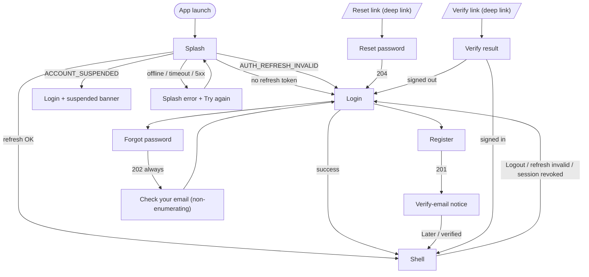
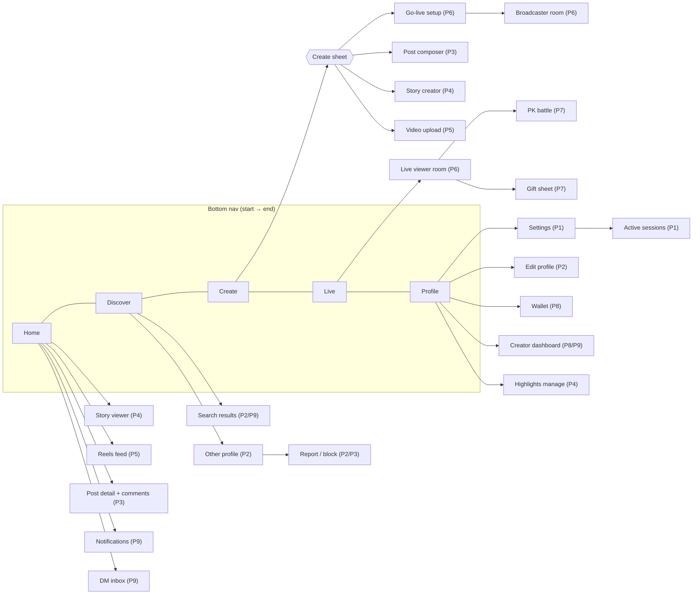

# Kabso Live — Screen Inventory (Phases 1–11)

Status: **Specification (KL-004).** Lists every planned mobile screen, its phase (from
[`../IMPLEMENTATION_PLAN.md`](../IMPLEMENTATION_PLAN.md)), and the states it must handle.
Components refer to [`DESIGN_SYSTEM.md`](DESIGN_SYSTEM.md) §9. Phase 1 screens are fully
specified in [`PHASE1_SCREENS.md`](PHASE1_SCREENS.md). Admin web panel (Phase 10) is out of
scope for this mobile inventory.

**State legend** (required states column):
`L` loading · `E` empty · `Er` error (code-mapped, PHASE1_SCREENS §10) · `O` offline ·
`P` permission denied (camera/mic/photos/notifications) · `R` restricted (private, blocked,
suspended, age/region, `AUTH_FORBIDDEN`) · `NF` not found / removed (`NOT_FOUND`).
Every screen with network data handles `L`, `Er`, `O` at minimum.

**Always-dark surfaces** (ignore theme): Live (all), Reels player, Story viewer/creator,
Camera, Gift sheet.

Global RTL rules apply everywhere (DESIGN_SYSTEM §3.4, §6.2); the RTL column lists only
screen-specific notes. Global a11y rules (§8) likewise.

---

## 1. Navigation map

### 1.1 Auth flow and session gate

### 1.2 Five-tab shell (StatefulShellRoute) and main push routes

Routing rules: each tab keeps its own stack; re-tap selected tab pops to root/scrolls to top;
full-screen routes (Live rooms, Reels, Story viewer, Camera) are pushed on the **root**
navigator (BottomNav hidden). Android back on a tab root goes to Home, then exits.

---

## 2. Onboarding / Auth

| Screen | Ph | Purpose | Entry | Key components | States | RTL notes | A11y notes |
| ------ | -- | ------- | ----- | -------------- | ------ | --------- | ---------- |
| Splash | 1 | Restore session, route | Launch | Wordmark, circular ProgressBar | L, Er, O | Wordmark is Latin, centred, never mirrored | Announce "Loading Kabso Live"; no timed-out auto-skip |
| Login | 1 | Email/username + password sign-in | Splash, logout, Register link | TopBar `large`, TextField (text, password), Button primary/text, language Chip | L (submit), Er, O, R (suspended) | Identifier & password inputs LTR, labels start-aligned | Autofill hints; error banner is live region; focus moves to first error |
| Register | 1 | Create account | Login | TextField ×4 incl. `username` with async status, Button | L, Er, O | Username/email LTR; helper text RTL | Availability changes announced politely |
| Forgot password | 1 | Request reset link | Login | TextField email, Button | L, Er, O | Email LTR | — |
| Forgot — sent | 1 | Non-enumerating confirmation | Forgot submit | EmptyState-like block, Button text (resend w/ countdown) | Er (429), O | Email isolated (`bidiIsolate`) in sentence | Countdown announced once, not every second |
| Reset password | 1 | Set new password from link | Deep link | TextField password ×2, Button | L, Er (`TOKEN_EXPIRED`, `TOKEN_INVALID`), O | — | Password rules visible as text, not colour only |
| Verify-email notice | 1 | Ask user to verify | After register; Profile banner | Illustration icon, Button secondary/text | L (resend/check), Er, O | Email isolated | — |
| Verify result | 1 | Outcome of verify link | Deep link | EmptyState / ErrorState | L, Er (`TOKEN_*`), O | — | Result announced |
| Account suspended | 1 | Explain suspension | Login/refresh `ACCOUNT_SUSPENDED` | Inline banner on Login + Dialog | R | — | Support contact as tappable link (B7) |
| Profile setup (avatar, bio) | 2 | First-run profile completion | After first verify/login | Avatar `lg` picker, TextField multiline, Button | L, Er, O, P (photos) | — | Skip is a real button, not a gesture |
| Follow suggestions | 2 | Seed follow graph | After profile setup | ListTile `user`, Button small | L, E, Er, O | — | "Follow" buttons have name in label ("Follow Sara") |
| Phone sign-up / OTP | — | Phone auth | Login | — | — | — | **Blocked (B3)** — not scheduled |
| Social sign-in | — | Apple/Google | Login | — | — | — | Not scheduled; never use third-party logos without brand approval |

## 3. Shell and Home

| Screen | Ph | Purpose | Entry | Key components | States | RTL notes | A11y notes |
| ------ | -- | ------- | ----- | -------------- | ------ | --------- | ---------- |
| Tab shell | 1 | 5-tab container | After auth | BottomNav, TopBar | — | Tab order mirrors; Create centre | Tabs expose "tab, 1 of 5, selected" |
| Home (Phase 1 placeholder) | 1 | Honest "coming" state | Tab | EmptyState `comingSoon(2)` | — | — | — |
| Home feed | 2 (skeleton) / 3 (posts) | Following feed | Tab | TopBar (wordmark at start; notifications + DM IconButtons at end), Stories tray (P4), Post cards, Skeleton | L, E ("Follow people to fill your feed"), Er, O (cached items + offline banner) | Stories tray scrolls from start | Post card read as one node with actions as custom actions |
| Stories tray | 4 | Entry to stories | Home top | Avatar `story` rings (unseen first), own "Add story" | L, E (only own add), Er (silent, retry on pull) | Order starts at `start` | Ring state in label ("Sara, new story") |
| Home segment: Following / Reels | 5 | Switch to Reels | Home TopBar Tabs | Tabs `fixed` | — | Segment order mirrors | — |

## 4. Discover

| Screen | Ph | Purpose | Entry | Key components | States | RTL notes | A11y notes |
| ------ | -- | ------- | ----- | -------------- | ------ | --------- | ---------- |
| Discover (Phase 1 placeholder) | 1 | Honest "coming" | Tab | EmptyState `comingSoon(9)` | — | — | — |
| User search (basic) | 2 | Find people by name/username | Discover search field | TextField search, ListTile `user` | L, E (no results), Er, O | Mixed-script results isolated | Results count announced |
| Discover home | 9 | Trending lives, reels, creators | Tab | Tabs, Live tiles, Video tiles grid, Chips (categories) | L, E, Er, O | Category chips scroll from start | Grid items labelled with creator + type |
| Search results (all/users/tags/lives) | 9 | Full search | Discover | Tabs `scrollable`, ListTile, tiles | L, E, Er, O | — | — |
| Hashtag page | 9 | Content for a tag | Tag tap | TopBar, Counter, media grid | L, E, Er, O, NF | `#tag` isolated | — |

## 5. Create

| Screen | Ph | Purpose | Entry | Key components | States | RTL notes | A11y notes |
| ------ | -- | ------- | ----- | -------------- | ------ | --------- | ---------- |
| Create (Phase 1 placeholder) | 1 | List upcoming creation types | Centre tab | ListTile ×4 with `phase` Badges (Post P3, Story P4, Video P5, Live P6), all disabled | — | — | Disabled rows announce phase |
| Create sheet | 3 (grows to 6) | Choose what to create | Centre tab tap | BottomSheet, ListTile/large icon buttons | — | — | Sheet title announced; dismiss by back |
| Media picker | 3 | Pick photos/videos | Create sheet | Grid (3 col), selection Counter badges, Button | L, E (no media), P (photos — limited/denied with "Open settings") | Selection order numbers stay Latin | Selected index announced |
| Post editor (crop/order/filters) | 3 | Prepare carousel | Picker | Carousel, Chips, Button | L, Er | Carousel swipes in reading direction | Reorder via accessible move up/down actions |
| Post details & publish | 3 | Caption, tags, privacy | Editor | TextField multiline, ListTile `toggle`, Button | L (upload with linear ProgressBar), Er (retry keeps draft), O (queue disabled — show error) | Caption RTL/LTR auto by first strong char | Upload progress announced at 25 % steps |
| Story camera / creator | 4 | Capture & decorate story | Create sheet, tray "Add" | Camera preview, IconButton `filled`, text tool, Button | P (camera/mic), L (upload), Er, O | Text tool alignment follows typed script | Shutter button labelled; long-press video has alternative button |
| Video upload / editor | 5 | Trim, cover, caption | Create sheet | Video preview, trim scrubber (LTR), TextField, Button | P, L (upload + processing), Er, O | Scrubber never mirrors | Trim handles adjustable via semantics increase/decrease |
| Go-live setup | 6 | Title, cover, category, start | Create sheet, Live tab | Camera preview, TextField, Chips, Button `live` | P (camera/mic), L, Er (`SERVICE_UNAVAILABLE` → "Live is unavailable right now"), O, R (not eligible) | — | Countdown 3-2-1 announced; reduce motion → static number |

## 6. Live

| Screen | Ph | Purpose | Entry | Key components | States | RTL notes | A11y notes |
| ------ | -- | ------- | ----- | -------------- | ------ | --------- | ---------- |
| Live (Phase 1 placeholder) | 1 | Honest "coming" | Tab | EmptyState `comingSoon(6)` | — | — | — |
| Live tab (room list) | 6 | Browse live rooms | Tab | Tabs (For you / Following / Nearby later), Live room tiles 2-col, Skeleton | L, E ("No one is live right now"), Er, O | Grid fills from start | Tiles labelled host + viewers + title |
| Live viewer room | 6 | Watch, chat, follow | Tile, live ring avatar, notification | Video, TopBar `transparent` (host Avatar + Follow + viewers Counter + close), chat list on scrim (start side), input bar, IconButtons (gift P7, share, more) | L (connecting), Er (reconnecting banner, auto-retry), O, NF ("This live has ended"), R (blocked/kicked/age) | Chat bubbles align start; host pill at top-start, close at top-end | Chat announcements throttled (max 1 per 3 s, opt-in); captions N/A; reduce-motion disables like hearts |
| Broadcaster room | 6 | Host controls | Go-live setup | Camera, viewers Counter, chat, tools (flip, mute, beauty later, moderators), End button `destructive` | P, L, Er (network quality warning), O (auto reconnect 30 s then end prompt) | Tools column on end side | End requires Dialog |
| Live chat moderation sheet | 6 | Mute/kick/report viewer, assign moderators | Long-press chat name | BottomSheet, ListTile `destructive` | L, Er | — | Actions name the target user |
| Audience list sheet | 6 | Viewers & top gifters | Viewers Counter | BottomSheet, Tabs, ListTile `user` with rank (gold 1–3) | L, E, Er | Rank numbers Latin | Rank in label |
| Live end summary (host) | 6 | Duration, viewers, new followers, gifts (P7) | End live | `display` numbers, Counter `stat`, Button | L, Er | — | Stats read as label/value pairs |
| Live ended (viewer) | 6 | Room closed | Room end event | EmptyState + host follow + suggested lives | E | — | — |
| Multi-guest room | 7 | Up to N guests in grid | Viewer "Request to join" / host invite | Video grid (2×2/3×3), guest slot Avatars, Badge, BottomSheet (requests) | P (mic/cam for guests), L, Er, O, R | Grid fills from start; host slot first | Each tile labelled with name + mic state |
| Guest request sheet | 7 | Host accepts/declines | Host toolbar | ListTile `user` + Buttons | L, E, Er | — | — |
| PK invite / matchmaking | 7 | Start PK | Broadcaster tools | BottomSheet, ListTile `user`, timer | L, E, Er, O | — | Timer announced at start/end only |
| PK battle | 7 | Split-screen battle with server scores | PK start event | Split video (host `start`/opponent `end`), PK bar (`pkLeft`/`pkRight`, mirrors), `display` scores ≥ 20/700, timer, `pk` Badge, top-gifter Avatars, result overlay | L, Er (desync → "Reconnecting scores"), O | Host always on start side | Scores exposed as text "You 1,200 – 980"; result announced |
| Gift sheet | 7 | Send gifts | Gift IconButton | DESIGN_SYSTEM §9.11 | L, E, Er, O, insufficient balance | Grid fills from start | Each gift: name + price; Send announces total |
| Gift animation layer | 7 | Show received gifts | Realtime events | Banners (start side), full-screen layer | — | Banners enter from start | Reduce motion → banners only (§7.3) |
| Top gifters ranking | 7 | Room/daily ranking | Audience sheet | Tabs, ListTile with rank | L, E, Er | — | — |

## 7. Reels

| Screen | Ph | Purpose | Entry | Key components | States | RTL notes | A11y notes |
| ------ | -- | ------- | ----- | -------------- | ------ | --------- | ---------- |
| Reels feed (vertical) | 5 | Full-screen short video | Home segment, video tile | Video player, overlay actions column (like, comment, share, more) on end side, caption on bottom scrim, Counter `overlay`, progress line | L (first frame poster), E, Er (per-item "Couldn't play — tap to retry"), O (cached only) | Action column on end side; caption block start-aligned; scrubber LTR | Swipe up/down also via "Next/Previous video" semantics actions; captions/subtitles when available; mute state announced |
| Reel comments sheet | 5 | Comment on a reel | Comment icon | BottomSheet, ListTile, TextField + send (flips) | L, E, Er, O, R (comments off) | — | — |
| Upload processing status | 5 | Own video processing | Profile grid, upload toast | Video tile processing overlay, ProgressBar | L, Er ("Processing failed — try again") | — | Status in tile label |

## 8. Stories and Highlights

| Screen | Ph | Purpose | Entry | Key components | States | RTL notes | A11y notes |
| ------ | -- | ------- | ----- | -------------- | ------ | --------- | ---------- |
| Story viewer | 4 | View stories (and highlights) | Tray, avatar ring, highlight | ProgressBar `storySegments`, header (Avatar `sm`, name, time, close), reply TextField + send, like | L (per item), Er (skip after 3 s with toast), O, NF (expired), R | Segments fill start → end; tap end = next; swipe to start = next user | Pause on screen-reader focus; "Next/Previous story" actions; story text exposed |
| Story creator | 4 | (see Create) | — | — | — | — | — |
| Story viewers list | 4 | Who viewed own story | Own story "Seen by" | BottomSheet, ListTile `user`, Counter | L, E, Er | — | — |
| Story archive | 4 | Past own stories | Profile menu | Grid (3 col) grouped by date | L, E, Er, O | Dates Gregorian, Latin digits | — |
| Highlights row | 4 | On profiles | Profile | Avatar `story` (seen ring) + caption | L, E (own: "New" only) | Scrolls from start | — |
| Highlight create / edit / manage | 4 | Name, cover, choose stories, reorder, delete | Profile highlights "New"/long-press | TextField, archive grid with selection, Button, Dialog `destructive` | L, E (archive empty), Er, O | — | Reorder via accessible actions |

## 9. Profile

| Screen | Ph | Purpose | Entry | Key components | States | RTL notes | A11y notes |
| ------ | -- | ------- | ----- | -------------- | ------ | --------- | ---------- |
| Own profile — Phase 1 basics | 1 | Show signed-in user | Tab | See PHASE1_SCREENS §7 | L, Er, O | — | — |
| Own profile — full | 2/3/5 | Stats, bio, grids, highlights | Tab | Avatar `lg` (live ring when live), Counter `stat` ×3, Buttons (Edit, Share), highlights row, Tabs `icon` (posts P3 / reels P5 / tagged P3), media grid | L, E per tab, Er, O | Stats order mirrors (posts at start) | Stats tappable with full numbers |
| Edit profile | 2 | Name, username, bio, avatar, privacy link | Own profile | TextField ×3 incl. username availability, Avatar picker, TopBar `modal` | L, Er (`USERNAME_TAKEN`, `VALIDATION_FAILED`), O, P (photos) | — | Unsaved-changes Dialog on close |
| Other profile (public) | 2 | View/follow someone | Search, mentions, lists | as own + Follow/Message buttons, overflow (report/block) | L, Er, O, NF ("This account isn't available") | — | Follow state change announced |
| Other profile (private) | 2 | Restricted view | as above | Header + counts only, EmptyState `restricted` ("This account is private"), Follow → "Requested" | R | — | — |
| Blocked / blocking profile | 2 | Blocked state | as above | Header minimal, "You blocked this account" + Unblock | R | — | — |
| Followers / Following | 2 | Lists | Counter tap | Tabs, ListTile `user`, search field | L, E, Er, O, R (private) | — | — |
| Follow requests | 2 | Approve/decline | Own profile (private) / notifications | ListTile `user` + Buttons small | L, E, Er, O | Approve at end side (primary) | — |

## 10. Posts and comments

| Screen | Ph | Purpose | Entry | Key components | States | RTL notes | A11y notes |
| ------ | -- | ------- | ----- | -------------- | ------ | --------- | ---------- |
| Post detail | 3 | Single post | Feed, grid, deep link, notification | Post card, comments preview | L, Er, O, NF, R | Carousel swipe follows reading direction | Carousel position "2 of 4" |
| Comments | 3 | Threaded comments | Post, "View all" | ListTile (avatar, name, text, time, like), replies (indented `xl` at start), TextField + send | L, E ("Be the first to comment"), Er, O, R (comments off / limited) | Reply indent on start side | Each comment one node; reply action labelled |
| Likes list | 3 | Who liked | Like Counter | ListTile `user` | L, E, Er | — | — |
| Share sheet | 3 | Share to DM (P9), copy link, system share | Share icon | BottomSheet, Avatar row, ListTile | L, Er | Avatar row from start | — |
| Saved | 3 | Saved posts | Profile menu | Grid | L, E, Er, O | — | — |

## 11. DMs (Phase 9)

| Screen | Ph | Purpose | Entry | Key components | States | RTL notes | A11y notes |
| ------ | -- | ------- | ----- | -------------- | ------ | --------- | ---------- |
| Inbox | 9 | Conversations | Home TopBar DM icon | ListTile `user` (last message, time, unread `dot`), Tabs (Primary/Requests) | L, E, Er, O | Unread dot at end | Unread count in label |
| Conversation | 9 | Chat | Inbox, profile "Message" | Bubbles (own at end, other at start), TextField + send (flips), media, typing indicator | L, E, Er (per-message "Not sent — tap to retry"), O (queue + clock icon), R (blocked / can't message) | Own bubbles on end side; timestamps Latin digits | Each message: sender, text, time, status |
| New message | 9 | Pick recipient | Inbox | Search TextField, ListTile `user` | L, E, Er | — | — |
| Message requests | 9 | Accept/decline | Inbox tab | ListTile + Buttons | L, E, Er | — | — |

## 12. Notifications (Phase 9; follow requests already reachable in Phase 2)

| Screen | Ph | Purpose | Entry | Key components | States | RTL notes | A11y notes |
| ------ | -- | ------- | ----- | -------------- | ------ | --------- | ---------- |
| Activity | 9 | Likes, comments, follows, live starts, gifts | Home TopBar bell | ListTile (avatar, sentence with isolated names, time, thumbnail at end), section headers (Today / This week) | L, E, Er, O | Thumbnail at end | Grouped notifications read as one sentence |
| Push permission prompt (pre-prompt) | 9 | Explain before OS prompt | First relevant moment | Dialog | P (denied → Settings link) | — | — |

## 13. Wallet and gifts (Phase 8; real money blocked B5)

| Screen | Ph | Purpose | Entry | Key components | States | RTL notes | A11y notes |
| ------ | -- | ------- | ----- | -------------- | ------ | --------- | ---------- |
| Wallet home | 8 | Coin balance, actions | Profile menu, gift sheet "Top up" | `display` balance (exact, gold on dark), Buttons, ListTile | L, Er, O | Coin icon before number at start | Balance read "12,500 coins" |
| Coin store | 8 | Buy coin packages | Wallet | Card grid (package, store price verbatim), Button | L, E, Er, O, R (purchases disabled — B5: "Purchases aren't available yet") | Store price strings shown as provided | Price + coins in label |
| Purchase result | 8 | Pending/success/failed | Store flow | EmptyState/ErrorState | L (verifying receipt), Er, `IDEMPOTENCY_CONFLICT` | — | Result announced |
| Transactions | 8 | Ledger history | Wallet | ListTile (amount +/− with sign, time), filters Chips | L, E, Er, O | Signed amounts keep sign before digits (`+500`) in both locales | Sign spoken ("plus 500") |
| Gifts sent / received | 8 | Gift history | Wallet | Tabs, ListTile | L, E, Er, O | — | — |

## 14. Creator tools (Phase 8 earnings, Phase 9 analytics)

| Screen | Ph | Purpose | Entry | Key components | States | RTL notes | A11y notes |
| ------ | -- | ------- | ----- | -------------- | ------ | --------- | ---------- |
| Creator dashboard | 8/9 | Overview | Profile menu | Counter `stat` cards, chart (time axis LTR), ListTile | L, E (new creator), Er, O, R (not eligible) | Charts keep LTR time axis; legends RTL | Chart has table/summary alternative |
| Earnings | 8 | Diamonds/earnings ledger | Dashboard | ListTile, Counter (exact) | L, E, Er, O | — | — |
| Payouts | 8 | Payout setup | Dashboard | EmptyState `comingSoon` ("Payouts are disabled") | R | — | — |
| Analytics (posts, reels, lives) | 9 | Performance | Dashboard | Tabs, charts, tables | L, E, Er, O | as above | as above |

## 15. Settings, privacy, safety, sessions

| Screen | Ph | Purpose | Entry | Key components | States | RTL notes | A11y notes |
| ------ | -- | ------- | ----- | -------------- | ------ | --------- | ---------- |
| Settings root | 1 | Hub | Profile TopBar gear | ListTile groups | — | Chevrons flip | — |
| Appearance (theme) | 1 | Dark/Light/System | Settings | ListTile radio group | — | — | Radio semantics |
| Language | 1 | العربية / English | Settings, Login | ListTile radio group | — | Each language name in its own script/direction | Language names labelled in their own locale |
| Active sessions | 1 | List/revoke sessions | Settings › Security | ListTile, Badge "This device", Dialog `destructive` | L, E (only current), Er, O | — | Revoke button includes device name |
| Account info | 1 | Email, verification, username (read-only) | Settings | ListTile `value` | L, Er | Email LTR | — |
| Logout | 1 | Sign out | Settings | ListTile `destructive`, Dialog | L | — | — |
| About | 1 | Version, licenses; Terms/Privacy links (B7) | Settings | ListTile | — | — | — |
| Change password | 2* | Change while signed in | Settings › Security | TextField ×3, Button | L, Er, O | — | *Needs a contract endpoint (not in openapi v1) |
| Privacy | 2 | Private account, who can comment/message | Settings | ListTile `toggle`/`value` | L, Er (toggle reverts), O | — | — |
| Blocked accounts | 2 | Manage blocks | Settings › Privacy | ListTile `user` + Unblock | L, E, Er, O | — | — |
| Safety: comment filters / hidden words | 3 | Content controls | Settings › Privacy | Toggles, Chip `input` | L, Er, O | Words in any script | — |
| Live settings (who can gift/guest) | 7 | Live safety | Settings / Go-live | Toggles | L, Er | — | — |
| Notification settings | 9 | Push categories | Settings | Toggles | L, Er, P | — | — |
| Accessibility | 11 | Reduce motion override, captions default, chat announce | Settings | Toggles | — | — | — |
| Download your data | 11 | Export | Settings › Account | Button, status ListTile | L, Er | — | — |
| Delete account | 11 | Deletion with grace period | Settings › Account | Dialog `destructive`, password re-entry | L, Er | — | Two-step confirmation |

## 16. Report and block flows

| Screen | Ph | Purpose | Entry | Key components | States | RTL notes | A11y notes |
| ------ | -- | ------- | ----- | -------------- | ------ | --------- | ---------- |
| Block confirm | 2 | Block a user | Profile overflow, chat, live moderation | Dialog `destructive` (explains effects) | L, Er | — | — |
| Report sheet — reason | 2 (users) / 3 (posts, comments) / 6 (lives) / 9 (messages) | Choose reason | Overflow menus everywhere | BottomSheet, ListTile `navigation` (reasons), optional TextField details | L, Er, O | — | Reasons as radio list |
| Report — submitted | same | Confirmation + "Also block?" | Report submit | EmptyState-like, Buttons | Er | — | Confirmation announced |
| My reports / appeals | 10 | Track reports, appeal content takedowns | Settings › Safety, takedown notice | ListTile with status Badge | L, E, Er, O | — | — |
| Content removed notice | 10 | Explain takedown | Notification | Dialog/ErrorState `restricted` + Appeal | R | — | — |
